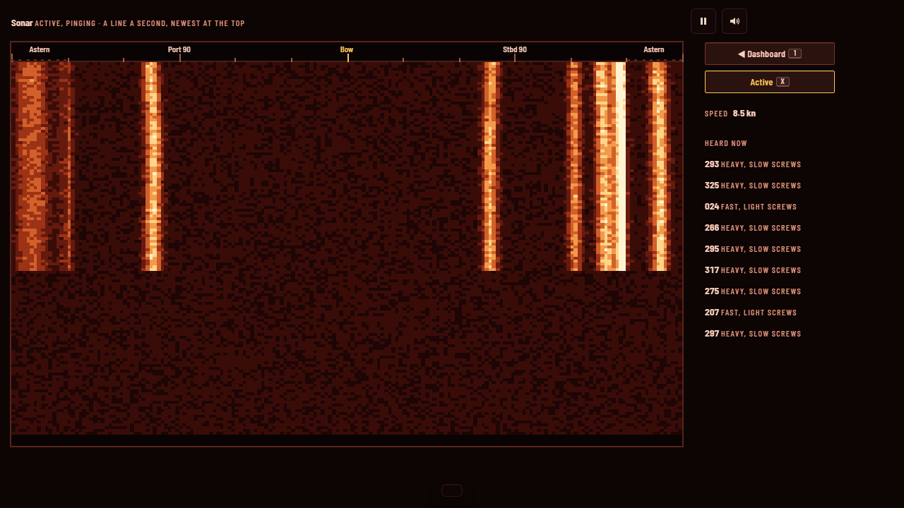

# The Long Convoy

**Defend civilian shipping from the Wolf Empire's submarine packs, or switch sides and take it apart.** A modern re-imagining of *Wolfpack* (NovaLogic, 1990, DOS): command the wolfpack's boats one at a time while the rest sail under their orders, or sail with the Pumacity Defense Fleet (the PDF) and bring the city's convoys through, in hi-bit pixel art, in a boat rigged for red light.

## Play

[greykit.com/games/thelongconvoy](https://greykit.com/games/thelongconvoy/)

No install required. Plain scripts, no build step, nothing fetched at play time: every picture is drawn and every sound synthesised in the page; the three typefaces ship with it.


## How it plays

Pumacity's convoys carry its oil, its ore and its troops between the islands, and the PDF's escorts ring them round. The Wolf Empire has a pack.

- **The dashboard**, as in 1990: the vessel you are aboard, every instrument at once. The view out in the big window (the periscope at periscope depth, the bridge on the surface), the map and the sonar's waterfall in small ones, the telegraph, compass and depth, the dive bubble with its emergency blow and crash dive, battery and fuel, the target and its lamp, and the boat's plan with her tubes, reloads, deck gun, snorkel, radar and noisemakers; on an escort the sonar scope and its passive/active switch, the charges' depth and the racks. Every control is a button with a key. **AUTO / USER CONTROL** hands the vessel to its orders while you watch.
- **The map runs the battle**, as in 1990: the depth in hard bands, the convoy as your side has seen it, and your whole side listed, a row a vessel: her order, depth, speed, battery, fuel, tubes, noisemakers, hull and her lamps (hunted, silent, charging, snorkelling; on an escort pinging, or too fast to hear). A click on a row selects her and a second takes command; a click on her order gives her the next one. The card at the lower left shows whichever vessel the mouse is over.
- **Every boat sails under her order:** Attack (her captain finds the convoy and goes in), Shadow, Patrol (her waypoints: a right click on the map), Evade, Drift, Charge, Periscope depth, Hold.
- **Take command of one boat at a time** (`Enter`, a second click, or `N` for the next): then the view out of her is yours, with her helm, telegraph and tubes.
- **Select and fire.** `T` or a click selects a ship; `Space` fires the spread at her, or at the nearest in range, one torpedo after another. The boat's fire control aims each, and says so when the angle is wrong for those tubes or the range too long. On the surface the deck gun's crew lay it themselves; `G` fires. Ships are traced from 3D models at their true angle on the bow.
- **The sonar**, after *688 Attack Sub*'s: a waterfall of what you hear, a band at each thing's bearing, brighter the louder, your own speed the noise floor; a depth charge a line right across. An escort's pings are heard going out and coming back off every hull in the beam; from a U-boat you hear them strike yours.
- **The pack shares what it sees**, and its news comes in its boats' names: who is firing, who is hunted, who is lost. When the boat you are on goes down, command passes to the next.

Eight missions after the 1990 game's, set in the Wolf War: from two boats against five unescorted ships, through the fuel tankers and a hunter-killer group, to eight boats in the decisive battle. And a custom mission of your own making, and target practice to learn the attack. A boat under water can drop a noisemaker for the escorts to hunt instead of her, and a boat whose radio is damaged can neither take your orders nor send you news.

**Or play the other side**, as the original let you: the **Pumacity Defense Fleet**, aboard one of the convoy's escorts, against a wolfpack whose boats sail under their own captains. Sprint and drift to hear them, ping with the sonar, run in over a contact and lay a pattern of depth charges set to its depth, throw the hedgehog late in the war, fight a surfaced boat with the guns, and give the other escorts their orders from the map (screen, hunt, patrol, hold). Eight missions have the PDF's side, among them the night defence of an anchorage.

Every mission ends with the 1990 game's debrief: who won, a score and one of eleven ratings, each side's vessels at the start and lost, every weapon's fired, hits and kills, and every boat by name.





## Reality, and Classic and Field

**Reality** is the war itself, set before a mission: limited visibility, convoy zig-zags, expert escorts, torpedo failures and port-only repairs. **Aids** never change the war: **Classic** is the instruments and your eyes; **Field**, the default, adds a solution line, torpedo tracks, range labels and key hints. `L` switches the set at sea.

## Keys

| | |
|---|---|
| `1` / `2` / `3` / `4` / `5` | the dashboard / the map / the sonar / damage (a U-boat's) / the captain's log |
| `J` / `I` | AUTO or USER CONTROL / the snorkel |
| Click, `O`, right click | on the map: select a vessel (her row in the list, her mark or her name tag), give her the next order, add her a waypoint |
| Click an order / wheel | in the map's list: her next order (`Shift`: the one before); on the map, her order tag opens her orders / zoom about the mouse |
| `Enter` / `N` | take command of the vessel selected / of the next |
| `W` `S` | telegraph |
| `A` `D` | the rudder, while held |
| `Q` `E` / `PgUp` `PgDn` | depth; `P` periscope depth, `U` surface, `C` crash dive |
| Arrows | in the view: train and raise the periscope, look round; on the map: the helm and telegraph |
| `T` / `H` / `B` | select the ship nearest the crosshair / swing onto the target / to the bow, again the stern |
| `Space` | fire the spread at the target, or the nearest in range; `F` forward or after tubes, `V` the spread (one to four) |
| `G` | man the deck gun; manned, fire it; `Shift`+`G` secures it |
| `X` / `K` / `Y` | silent running / a noisemaker / radar |
| `+` `−` / `Backspace` | time compression / back to 1x |
| `Esc` / `L` / `M` / `?` | pause / Classic or Field / sound / help |

On the PDF's side: `W` `S` and `A` `D` speed and helm, `X` sonar (passive or active), `Q` `E` the charges' depth (`Shift` for 100 feet), `V` the weapon (the diamond, double or wide pattern, or the hedgehog), `Space` lays it when the lamp says over the contact, `F` the hedgehog at once, `G` the guns, `T` the next boat up in sight for them (or click her in the view), `N` the next escort, and on the map `O` and a right click for the others' orders.

The dashboard's Blow and Crash buttons ask for a second click; `C` crash-dives at once. A gamepad works too; Help has its map. It is a desktop game: on a phone or a small window the page says so instead.

## Saves

Everything is in this browser's `localStorage` under keys starting `thelongconvoy_`: a mission in progress, the service record (each mission's best), the settings and the sound. Settings → *Forget everything* clears exactly those. Saves from when the game was PumaPack (`pumapack_`) move over the first time it opens.

## Code

```
js/engine/   the war, DOM-free: the sea, the boats of the pack, the ships and convoys, seeing and being seen, the escorts,
             torpedoes and the fire control, the missions, a step of it all, the captain and the orders each boat sails under
js/art/      the pixel art: the kit, the tracer, the ship models, the view out, the map, the title's painting, the sonar's
             waterfall, the dashboard, the damage report
js/          rendering, the HUD, input, sound and the title theme, the screens, settings and the record, and the loop
tools/       sim-check (the captain plays every mission headless, the whole pack at once), asset stamps and checks, icons, the share card
```

`node tools/sim-check.js` plays every mission headless: the fire control's solution hits, the pack sinks ships, the boats you are not on fire on their own, the escorts hunt, and a mission replays step for step and survives being saved and loaded half way. It plays the games side by side, one worker thread per core (`--jobs N` to choose, `--jobs 1` for one at a time), and prints them in the same order either way. `node tools/stamp-assets.js` stamps every script and stylesheet with its hash after an edit. `?play=<mission>&side=<pack|escorts>&seed=<n>&run=<steps>&station=<chart|sonar|damage>&awake=1` on the page drops straight into a mission, for testing and for pictures. `tools/ORIGINAL.md` is what the 1990 game's files hold, in our own words.

The Long Convoy began as a copy of [The Silent Patrol](https://greykit.com/games/thesilentpatrol/) and shares its sea, its boats and its view out; the screens, the controls and the code are its own. Its sonar's waterfall follows Attack Puma's.

## Credits

The original *Wolfpack* was made by NovaLogic, 1990. This remake is not affiliated with NovaLogic; no code, art or audio from it is used. The boats, the ships, the islands and the war are our own. The typefaces are Barlow Semi Condensed, Courier Prime and Pixelify Sans, under the SIL Open Font License; their licences are beside them in `fonts/`.

By Matthew "Shan" Romanek, with Claude. Built by [greykit.com](https://greykit.com/).

Made for my own play. Nothing here is offered: no support, no updates, no licence.
