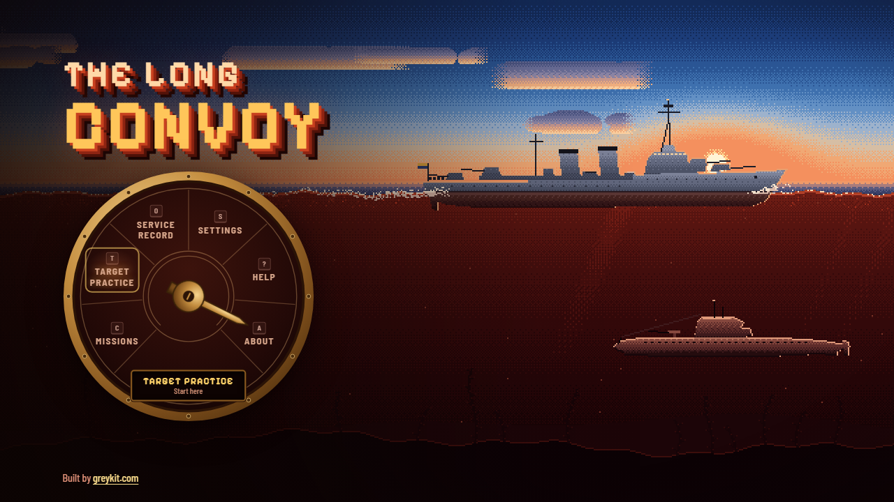
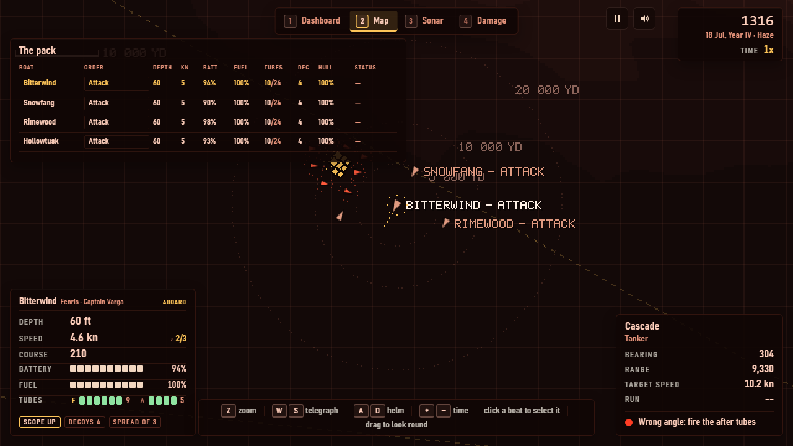
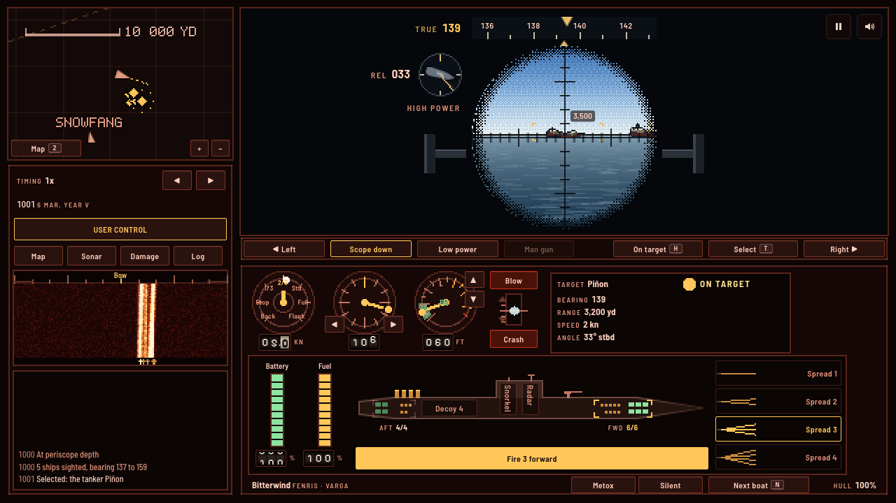
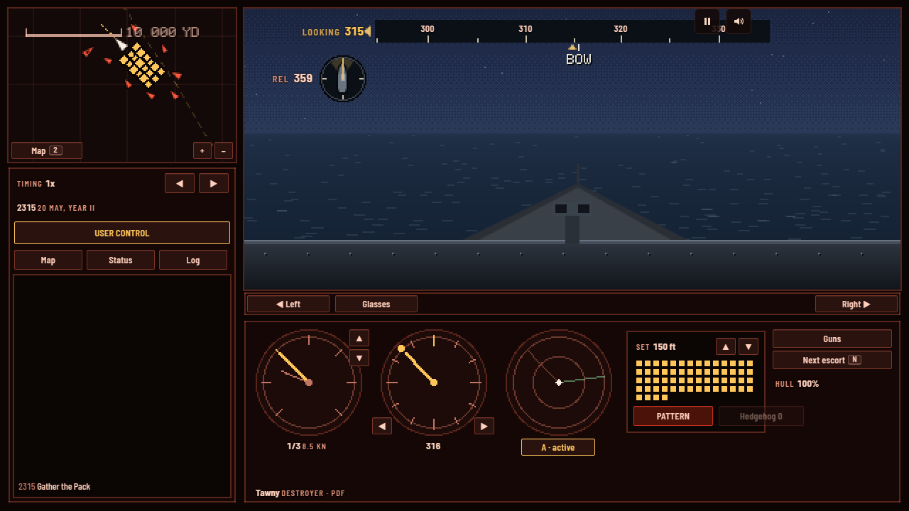
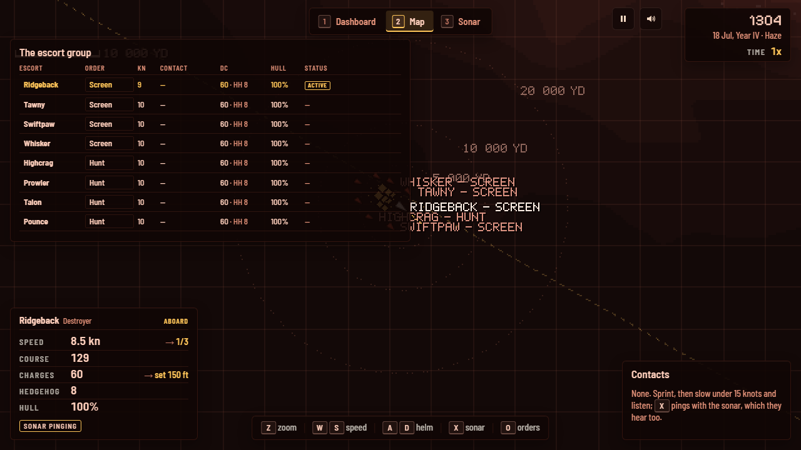

# PumaPack

**The Wolf Empire's wolfpack against Pumacity's convoys, and the fleet that escorts them.** A remake of *Wolfpack* (NovaLogic, 1990, DOS): command the wolfpack's boats one at a time while the rest sail under their orders, or sail with the Pumacity Defense Fleet (the PDF) and bring the city's shipping through, in modern hi-bit pixel art, in a boat rigged for red light.

## Play

[greykit.com/games/pumapack](https://greykit.com/games/pumapack/)

No install required. Plain scripts, no build step, nothing fetched at play time: every picture is drawn and every sound synthesised in the page; the two typefaces ship with it.



## How it plays

Pumacity's convoys carry its oil, its ore and its troops between the islands, and the PDF's escorts ring them round. The Wolf Empire has a pack.

- **The dashboard**, as in 1990: the vessel you are aboard, every instrument at once. The view out in the big window, the map in a small one, the telegraph, compass and depth, battery and fuel, the tubes, the snorkel and the Metox radar warning; on an escort the sonar scope and its passive/active switch, the charges' depth and the racks. Every control is a button with a key. **AUTO / USER CONTROL** hands the vessel to its orders while you watch.
- **The map runs the battle**, as in 1990: the depth in hard bands, every boat of the pack, the convoy as the pack has seen it. Click a boat to select her: her class, captain, depth and order, and the orders to give her.
- **Every boat sails under her order:** Attack (her captain finds the convoy and goes in), Shadow, Patrol (her waypoints: a right click on the map), Evade, Drift, Charge, Periscope depth, Hold.
- **Take command of one boat at a time** (`Enter`, a second click, or `N` for the next): then the view out of her is yours, the periscope at periscope depth and the bridge on the surface, with her helm, telegraph and tubes.
- **Select and fire.** `T` or a click selects a ship; `Space` fires at her, or at the nearest in range. The boat's fire control aims the shot, and says so when the angle is wrong for those tubes or the range too long. Ships are traced from 3D models at their true angle on the bow; escorts hear, see and ping, and lay depth charges.
- **The pack shares what it sees**, and its news comes in its boats' names: who is firing, who is hunted, who is lost. When the boat you are on goes down, command passes to the next.

Eight missions after the 1990 game's, set in the Wolf War: from two boats against five unescorted ships, through the fuel tankers and a hunter-killer group, to eight boats in the decisive battle. And a custom mission of your own making. A boat under water can drop a noisemaker for the escorts to hunt instead of her, and a boat whose radio is damaged can neither take your orders nor send you news.

**Or play the other side**, as the original let you: the **Pumacity Defense Fleet**, aboard one of the convoy's escorts, against a wolfpack whose boats sail under their own captains. Sprint and drift to hear them, ping with the sonar, run in over a contact and lay a pattern of depth charges set to its depth, throw the hedgehog late in the war, and give the other escorts their orders from the map (screen, hunt, patrol, hold). Eight missions have the PDF's side, among them the night defence of an anchorage.

Every mission ends with the 1990 game's debrief: who won, a score and one of eleven ratings, each side's vessels at the start and lost, every weapon's fired, hits and kills, and every boat by name.









## Reality, and Classic and Field

**Reality** is the war itself, set before a mission: limited visibility, convoy zig-zags, expert escorts, torpedo failures and port-only repairs. **Aids** never change the war: **Classic** is the instruments and your eyes; **Field**, the default, adds a solution line, torpedo tracks, range labels and key hints. `L` switches the set at sea.

## Keys

| | |
|---|---|
| `1` / `2` / `3` / `4` / `5` | the dashboard / the map / damage / status / the log |
| `J` / `I` | AUTO or USER CONTROL / the snorkel |
| Click, `O`, right click | on the map: select a boat (her mark, her name tag, or her name in the panel), give her the next order, add her a waypoint |
| Click a boat's order / wheel | on the map: her orders menu at the mouse / zoom about the mouse |
| `Enter` / `N` | take command of the boat selected / of the next boat |
| `W` `S` | telegraph |
| `A` `D` | helm |
| `Q` `E` / `PgUp` `PgDn` | depth; `P` periscope depth, `U` surface, `C` crash dive |
| Arrows | in the view: train and raise the periscope, look round; on the map: the helm and telegraph |
| `T` | select the ship nearest the crosshair |
| `Space` | fire at the target, or the nearest in range; `F` forward or after tubes, `V` a spread |
| `X` / `K` / `Y` / `G` | silent running / a noisemaker / radar / man the deck gun |
| `+` `−` / `Backspace` | time compression / back to 1x |
| `Esc` / `L` / `M` / `?` | pause / Classic or Field / sound / every key |

On the PDF's side: `W` `S` and `A` `D` speed and helm, `X` sonar, `Q` `E` the charges' depth (`Shift` for 100 feet), `V` the weapon (the diamond, double or wide pattern, or the hedgehog), `Space` lays it when the lamp says over the contact, `F` the hedgehog at once, `G` the guns, `T` the next boat up in sight for them (or click her in the view), `N` the next escort, and on the map `O` and a right click for the others' orders.

A gamepad works too; Help has its map.

## Code

```
js/engine/   the war, DOM-free: the sea, the boats of the pack, the ships and convoys, seeing and being seen, the escorts,
             torpedoes and the fire control, the missions, a step of it all, the captain and the orders each boat sails under
js/art/      the pixel art: the kit, the tracer, the ship models, the view out, the map, the damage report
js/          rendering, the HUD, input, sound, the screens, settings and the record, and the loop
tools/       sim-check (the captain plays every mission headless, the whole pack at once), asset stamps and checks, icons, the share card
```

`node tools/sim-check.js` plays every mission headless: the fire control's solution hits, the pack sinks ships, the boats you are not on fire on their own, the escorts hunt, and a mission replays step for step and survives being saved and loaded half way. `node tools/stamp-assets.js` stamps every script and stylesheet with its hash after an edit. `tools/ORIGINAL.md` is what the 1990 game's files hold, in our own words.

PumaPack began as a copy of [Puma Service](https://greykit.com/games/pumaservice/) and shares its sea, its boats and its view out; the screens, the controls and the code are its own.

## Credits

The original *Wolfpack* was made by NovaLogic, 1990. This remake is not affiliated with NovaLogic; no code, art or audio from it is used. The boats, the ships, the islands and the war are our own.

By Matthew "Shan" Romanek, with Claude. Built by [greykit.com](https://greykit.com/).

Made for my own play. Nothing here is offered: no support, no updates, no licence.
